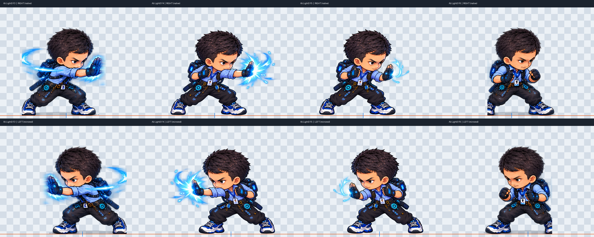

# Ali V6 F3/F6 — laporan tepi terpotong terpisah

Status: TEMUAN VISUAL BELUM SELESAI. Tidak ada artwork Ali yang diubah.

Pemeriksaan ulang lembar native/mirror menunjukkan tepi vertikal lurus pada
siluet warisan F3/F6, terutama dekat kaki dan sisi badan/FX. F4/F5 lengkap,
tetapi tidak menghapus masalah kontinuitas terhadap kedua frame warisan.

Kolom berikut menghitung piksel alpha >=32 pada x paling kiri yang memiliki
alpha nonzero. Angka ini adalah diagnostik tepi, bukan penilaian anatomi otomatis.

| Frame | Alpha bounds | Piksel terlihat pada kolom kiri | SHA-256 |
| --- | --- | --- | --- |
| F3 / light3-02.png | (106, 96, 526, 525) | 121 | `46c83081db5abd87c783c8ff11b691d445c1a364c984ff36acb45ef481dee16a` |
| F4 / light3-03.png | (106, 108, 629, 525) | 6 | `3b889fed8b57ea049aeb03470b296e7658c41f138adbdf0f7c85b9a24c420d66` |
| F5 / light3-04.png | (107, 103, 549, 524) | 7 | `21d619eca2aa7e1bcc2652c64bc734a0fcd00d3814ca616e20ec0d33ca95f3e6` |
| F6 / light3-05.png | (203, 95, 537, 525) | 201 | `a28f3dc7a9106d02577060cbf6c4b1cea5639f0b8450c4056fbb83571153fa79` |

Atlas V6 tetap: `1f71c0f4498acbe5e9d55c93953bb8ad294e0a7f33715092b0135b9b2da008c4`.

Seluruh pohon berkas Ali dipin dalam audit lokal sebelum pekerjaan V3 dan
diperiksa lagi sebelum penyerahan. Salinan bukti di direktori Elton ini bukan
revisi artwork Ali. Perbaikan F3/F6 membutuhkan pekerjaan Ali terpisah dan
review visual pemilik; pekerjaan Elton tidak menutup temuan ini.
