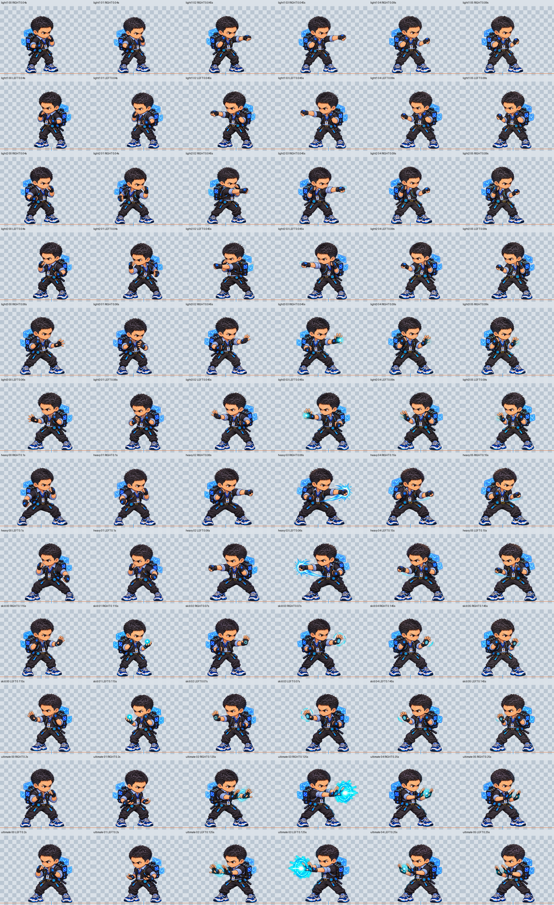
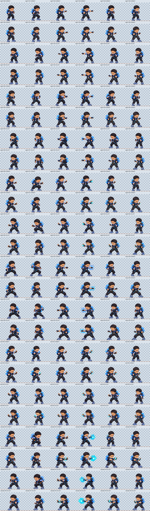

# Elton HD Visual Polish V3 — laporan review

**KANDIDAT, BELUM DISETUJUI. Validasi teknis lulus; bebas flicker/foot sliding belum dapat disertifikasi. Issue #31 tetap terbuka.**

## Berkas untuk review independen

Unggah `two-facings-v3.png` dan Markdown ini sebagai dua berkas terpisah. Tambahkan `v2-v3-comparison.png` untuk membandingkan baseline. ZIP besar tidak diperlukan. PNG per gerakan tersedia di `by-move/` untuk pemeriksaan lebih dekat. Referensi resmi tetap `public/assets/fighters/elton.png`.

## Git dan baseline

- Branch: `review/elton-hd-candidates-2026-11-12`; [Draft PR #30](https://github.com/eltonmalumbot/penaburcombat/pull/30); [Issue #31](https://github.com/eltonmalumbot/penaburcombat/issues/31).
- Awal pekerjaan bersih; fetch dan fast-forward dari `1ff7013` ke `cbe412611a1ce8ca9d9a3c8b178e141ee8e5945d` mempertahankan kedua refactor terbaru.
- Atlas V2 dipertahankan: `238acc8beaa136dc433e2a684c574e81db67d8bcf488c764cdd0e25d1077c1d6`.
- ZIP V2 asli dipertahankan terpisah: `29cbfc674d139115a1effa3380541d6c88684b696c1630607341c24bb14af103`.
- Atlas V3 baru: `279236de558e6b84bb4d72d4fd51fb2422c60ecdb0bc39a0ac4c1f041ee41988`.
- Seluruh pohon berkas V2, ZIP V2 asli dan pohon berkas Ali dipin sebelum perubahan serta diverifikasi byte-identik sebelum penyerahan. Tidak ada reset, force push, merge ke main atau deployment production.
- Full V3 lokal: `.local-art/elton-hd-v3/`; full source kerja: `.local-art/elton-v3-work/`. ZIP V3 terpisah: `.local-art/elton-hd-v3.zip`. Full PNG, raw generations dan provenance tidak masuk production assets.

## Perubahan pada 36 frame

Semua `light1`, `light2`, `light3`, `heavy`, `skill`, `ultimate` F00–F05 direvisi menggunakan image generation dengan referensi V2, Elton resmi, satu panduan pakaian V3, dan stance per gerakan. F04/F05 kemudian digambar ulang pada putaran kedua menggunakan contact V3 dan recovery sebelumnya untuk mengurangi arm swap serta snap ke guard. Ada 48 hasil generasi V3; 36 dipakai, 12 percobaan pertama disimpan sebagai superseded, bukan ditimpa/dihapus.

Pakaian luar hitam dan cuff biru lebih konsisten; emblem lengan tambahan dihapus. Badge portrait tetap tunggal pada lanyard biru, dengan pola backpack, buckle dan gadget lebih seragam. Ini bukan klaim kesamaan piksel semua detail kecil.

Ekspor hanya membersihkan alpha generator <8/255, menskalakan seluruh gambar secara seragam, lalu mentranslasikannya ke ground/pivot. Tidak ada anggota tubuh yang ditempel, deformasi per anggota tubuh, atau penggantian frame dengan cutout fallback. Setiap operasi dan SHA raw disimpan pada `export-records-v3.json` dalam paket lokal. Model revision/seed tidak diekspos oleh tool.

| Gerakan | Perbaikan yang terlihat | Review yang masih diperlukan |
| --- | --- | --- |
| Light1 | Jab F02/F03 jelas; F04/F05 mempertahankan lengan yang sama dan masih terulur sebagian | Recovery 04/05 masih mirip; cek detail glove/badge dan perpindahan berat |
| Light2 | Cross diikuti penarikan lengan bertahap, bukan kembali langsung ke neutral guard | Overlap lengan/putaran bahu pada 01→02 perlu penilaian anatomi independen |
| Light3 | Jongkok ekstrem F01 dikurangi; recovery mempertahankan telapak terbuka | Bentuk tangan dan perpindahan telapak kaki masih perlu animator review |
| Heavy | **F02 sudah berupa pukulan terulur/contact**, F03 full extension dengan burst; recovery tetap follow-through | Stance dan volume badan masih berubah sedikit; belum bebas foot sliding |
| Skill | Tangan charge/contact yang sama, ring mengecil pada recovery; tangan tidak jatuh ke pinggul | Glyph layar, jari dan badge masih berubah sedikit |
| Ultimate | Kedua telapak tetap terbuka di F04/F05 dengan cahaya memudar; tidak langsung berubah ke fist guard | Posisi tangan/FX dan detail peralatan masih memerlukan review kehalusan |

## Pengukuran kaki dan alpha

Semua frame PNG RGBA 720×540, native kanan, logical pivot (320,525). Ground alpha: [525]; margin minimum terukur 15 px. Mirror memakai pivot x=400 pada canvas 720 px. Kedua kaki dan sepatu tampak lengkap pada sheet.

Tabel adalah rentang perubahan centroid alpha telapak pada y=500–524 sepanjang enam frame, dalam piksel native, kiri/kanan layar. Centroid dipengaruhi rotasi dan bentuk sepatu: bukan bukti otomatis bahwa kaki bergeser, dan penurunan angka bukan sertifikat kaki planted.

| Gerakan | V2 kiri/kanan | V3 kiri/kanan |
| --- | --- | --- |
| light1 | 27.56/19.68 | 24.97/22.92 |
| light2 | 41.86/30.44 | 22.44/19.76 |
| light3 | 48.07/42.24 | 35.45/35.67 |
| heavy | 62.83/50.99 | 31.88/32.56 |
| skill | 44.66/39.42 | 34.59/32.38 |
| ultimate | 53.28/44.76 | 27.25/25.60 |

Rentang umumnya berkurang, tetapi **belum nol**; Light1 sisi kanan sedikit meningkat. Generator tidak mengunci skeleton/geometri antargambar. Karena itu, tidak ada klaim seluruh foot sliding, jitter, perubahan glyph, atau hard cut telah hilang. Revisi manual animator atau review pemilik tetap diperlukan sebelum gate visual ditutup.

## Validasi dan keterbatasan

- Pipeline nyata V3 memverifikasi 36 frame/atlas, SHA-256, alpha/margin, urutan, nonlooping mode, duplikasi decoded RGBA, dan pin referensi resmi.
- Timing setiap gerakan dibandingkan langsung dengan `src/game/moves.ts`: startup F00/F01, active F02/F03, recovery F04/F05 tetap sama. Tidak ada perubahan damage, hitbox, AI, meter atau aturan game.
- 47 tes Node; 20 tes Python (termasuk 3 tes evidence V3 sintetis); source/test TypeScript + Vite build; 25 gameplay Chromium; 28 atlas Chromium lulus. Fixture sintetis menguji alat, bukan anatomi artwork.
- Reviewer kandidat nyata menjalankan 72 screenshot dan 36 playback nonlooping pada kedua arah dan 1x/0.5x/0.25x, serta menolak PNG yang SHA-nya berubah. 36 WebP diagnostik didekode ulang untuk memverifikasi durasi setiap frame. Ini membuktikan urutan/timing/control, bukan kelancaran perseptual.
- Browser gameplay tetap memakai sprite resmi/fallback. Artwork V3 belum diaktifkan di dalam game, belum default dan belum diuji perangkat Android/iPhone fisik.
- Agen memeriksa enam sheet native/mirror dan perbandingan. Review visual independen dan persetujuan pemilik **PENDING**. Detail portrait ID, glyph layar, jahitan/aksesori, proporsi kepala/sepatu dan bentuk jari masih perlu dicermati; jangan menyimpulkan approved dari build/test pass.
- Halaman PR #30 menampilkan SonarCloud Quality Gate passed dan Vercel Ready pada head awal cbe4126. GitHub GraphQL masih Forbidden, dan akses API/Preview dibatasi proxy; status remote untuk commit V3 baru belum diklaim terverifikasi.
- Laporan Ali terpisah: [ALI-V6-EDGE-REPORT.md](ALI-V6-EDGE-REPORT.md). Tidak ada perubahan artwork Ali.

## Daftar lengkap frame yang berubah dan SHA-256 V3

Semua 36 frame berubah dari V2. SHA V2 untuk setiap nama ada di `revisions-v3.json`; SHA V3 berikut adalah byte PNG final, juga tercatat dalam `manifest-v3.json`.

| Frame | SHA-256 V3 |
| --- | --- |
| `light1-00.png` | `ab958b854216d44170a13255a0d119e668ef73f962141d33722d3351958cbe11` |
| `light1-01.png` | `9db135614468ae05192bf1a5a57df8a372e7f6bb2c66cca307bd0ef7b022de16` |
| `light1-02.png` | `89a43089893307c51f017187c4250f21ccf566853040a09bdaff203b7ca864a7` |
| `light1-03.png` | `970946ff4cc16aa6b521f027875e0f3df0600b07141daa77c0267234ef553f92` |
| `light1-04.png` | `005bee02e94d7754eefb6606e350729449c7ec68b3eeeab065484c6c6252659d` |
| `light1-05.png` | `c1b42cf9fc6f7a464a429aa7ed7b3e11c8540990345e1b4689c42005938c5f4d` |
| `light2-00.png` | `3fc9310f80faa8e00a3d0f96f7b74c6a8482a119219116375fdba7d6ffe3417b` |
| `light2-01.png` | `a147dc5a2ad5ccba1892f0026b185589d024163b7872a3265988b80785a2271a` |
| `light2-02.png` | `c417692b7f4c48b980d9870e0a9fcad618cd0692c34c9286da3dbbebd2c4801a` |
| `light2-03.png` | `d91f5f1a5d61595735e0305cce34522a9d9c22936b6cb0bf908f75bba75c7712` |
| `light2-04.png` | `6451f0482749169bcb0910e1295edc5f9e3c76e90b2ed0820e793c0475b29139` |
| `light2-05.png` | `8b1ecefe7da883025b27888f363a4691c468383a067fa2841f4d263d52453d58` |
| `light3-00.png` | `1c4f4bf865ccdcf8f3ba2811b1990bf822d8f07e49d36209fc947d32e603cc2d` |
| `light3-01.png` | `f9da527846ca11cdcb5de3372bf757349c1d777159642c9da696bcbabbe7ebe8` |
| `light3-02.png` | `b0d378eda87225c0b1209dab652d34094d8f5e6b159003a0e53cc032faffaac0` |
| `light3-03.png` | `e07adb29135c8c076d252efa7449ebe24af55673854e74acdcf51b4817471b96` |
| `light3-04.png` | `335ade1fe616310247609496185d90d5d65a8e06f0729a91b389eeed38d752af` |
| `light3-05.png` | `861b58a2258bc3e8e1459925512d876f6b0a3dcdb9609dd480ebe37e39ea41ec` |
| `heavy-00.png` | `abbdba3ad897f1013195de3457fb8394d04a332758d2b1146c7bb38ab9af3f8b` |
| `heavy-01.png` | `b342b05d1a7bee73373dbb3adef4636a607280cff1bf92e30e7d54a12e04d6de` |
| `heavy-02.png` | `aa7b983c8b45e168241fe5fa724d811855349a2e2101af91a572296a2fb8e7a5` |
| `heavy-03.png` | `0bd71446dc801636bd2e5759b07e741008be6253955ae05105132a71af40918c` |
| `heavy-04.png` | `b02ab2f0f8daf9415c26b8776ecb2b0baf9f1f082acc1e09b769951f2f85d78c` |
| `heavy-05.png` | `50bd13ab61913766e2f7921ccb35f9be5171e2bc5cb9e6410074b66e3078fbf7` |
| `skill-00.png` | `8b3c4ec0a8ffa1378616f15348c5329e8c5bddcd17e42f99eac87325ee293f9d` |
| `skill-01.png` | `c2a64587402870ae58d1440d4a80459df904bd655865aedfdc09e96e33689dcd` |
| `skill-02.png` | `116e8848a07d5430e743207b61eb47bdaae2096732bef7ccd408f630b4045746` |
| `skill-03.png` | `40b0962d6fedd1dc7126ea17d1912145d8ceab6989e5322a8643781193029c0b` |
| `skill-04.png` | `678ce9d44d844a764ca4e1da40f32beda9ea06a5644e06666e4407546a0de82b` |
| `skill-05.png` | `cd90f6b2f6dcd59a308b306d499b13a5ed5e95ecba33162da520e6b10cc44de0` |
| `ultimate-00.png` | `cc9a88c0519ed04879ae581e471d303caae853cd7c2379f319de44ffbf8e36ba` |
| `ultimate-01.png` | `82e9ae4c2ce5d20ebd4667e9c901e82c69a980b89b06b245265222ae45158e4f` |
| `ultimate-02.png` | `ead0ff3ab50d24564815b34a4c7d6d5c843438a9404e92df90f1674efc7c939d` |
| `ultimate-03.png` | `f353b6a4b16ea06d22ed42a22ef8dc72d88f05a368a862ae2ae61cd727b24436` |
| `ultimate-04.png` | `9bc4db08b18017140dcc472954a73934380ade5a2df507b56f46ecd97cf4e6fc` |
| `ultimate-05.png` | `e049a0a2f7b3156037e9ec9a9e9eee0497fedd346a3003b79d5fcdbf9a535321` |

Status akhir: paket V3 dapat direview; gate visual Issue #31 belum ditutup dan tidak ada persetujuan artwork otomatis.
